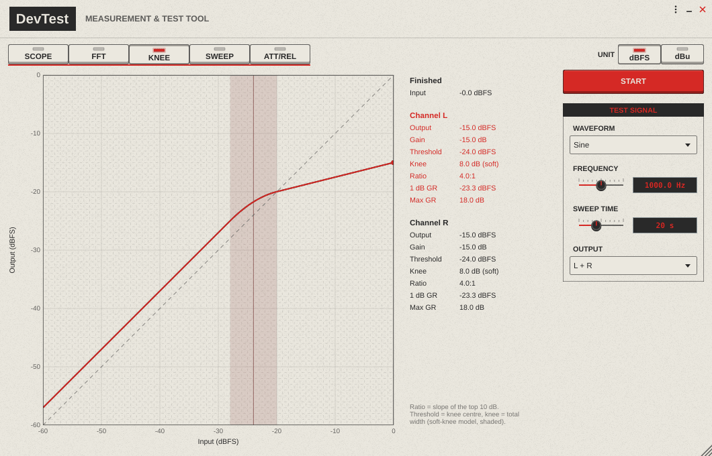
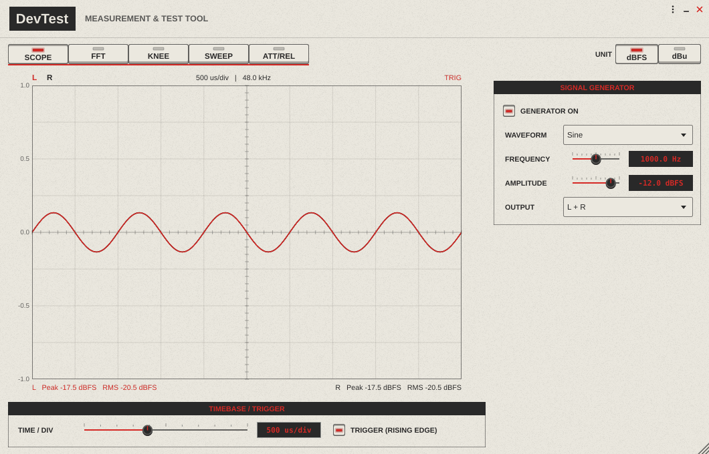
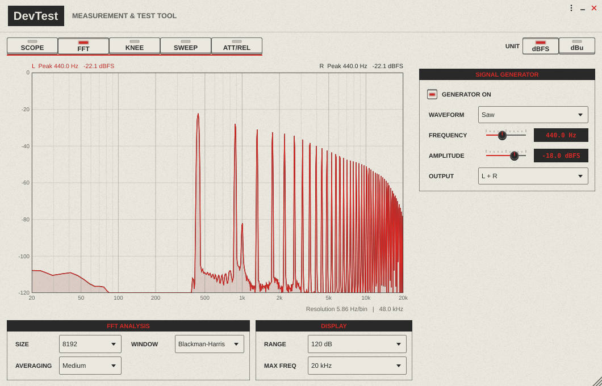
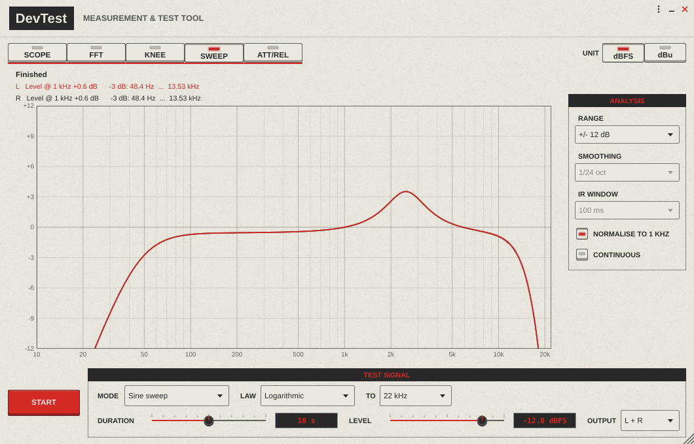
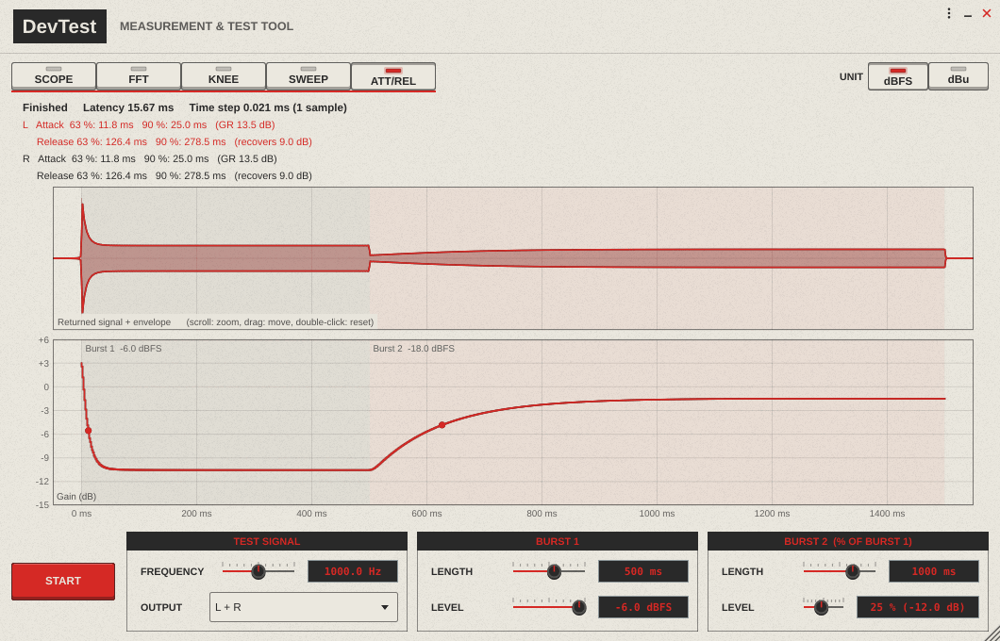
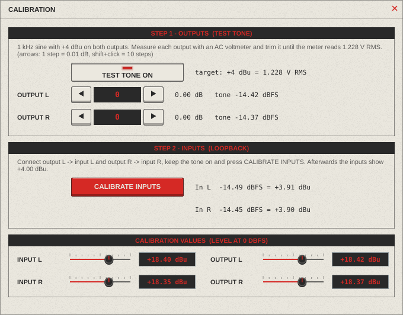

# DevTest

**Measurement & test tool for audio hardware and plugins** – oscilloscope, FFT analyser,
compressor transfer curve (knee), frequency response and attack/release measurement in
one window. DevTest runs as a **standalone application** (Windows, ASIO) and as a
**VST3 plugin**, e.g. in Ableton Live.



---

## Contents

- [Features](#features)
- [The tabs](#the-tabs)
  - [Scope](#scope)
  - [FFT](#fft)
  - [Knee](#knee)
  - [Sweep](#sweep)
  - [Att/Rel](#attrel)
- [Level units and calibration (dBFS / dBu)](#level-units-and-calibration-dbfs--dbu)
- [Standalone application](#standalone-application)
- [VST3 plugin](#vst3-plugin)
- [Measurement setup](#measurement-setup)
- [Building from source](#building-from-source)
- [Project structure](#project-structure)

---

## Features

| Tab | What it measures |
| --- | --- |
| **Scope** | Waveform of inputs L and R, trigger, peak and RMS level |
| **FFT** | Spectrum of L and R, up to 32768 points, peak frequency and level |
| **Knee** | Transfer curve of a compressor / limiter: threshold, knee width, ratio, gain reduction |
| **Sweep** | Frequency response with a sine sweep or with Dirac impulses |
| **Att/Rel** | Attack and release time of a compressor with two sine bursts |

- **Signal generator** (Scope and FFT): sine, saw, triangle, square (band-limited), 20 Hz – 20 kHz, −60 … 0 dBFS
- **Latency compensation**: Knee, Sweep and Att/Rel measure the loop latency (interface + device) with a click before every test, so the results do not depend on buffer sizes
- **dBFS or dBu**: all level displays can be switched to dBu after a calibration of the inputs and outputs
- **Both channels at once**: L and R are always measured together (L red, R black)
- Hardware-style user interface, freely resizable window

---

## The tabs

### Scope



- 10 × 8 divisions, ±1.0 = full scale (0 dBFS)
- Time base 20 µs … 100 ms per division
- Trigger on the rising edge of channel L with sub-sample interpolation, so even
  high-frequency signals stand still (`TRIG` / `FREE` top right)
- Peak and RMS level of both channels (last 300 ms)
- Signal generator on the right: **waveform**, **frequency**, **amplitude**, **output** (Off, L, R, L + R)

### FFT



- FFT size 1024 … 32768, windows Hann, Blackman-Harris, Flat-Top, Rectangular
- Averaging Off / Light / Medium / Heavy
- Display range 60 … 150 dB, frequency axis up to 20, 50 or 100 kHz (depending on the sample rate)
- Levels are calibrated: a sine with −12 dBFS peak is shown at −12 dB
  (most accurate with the Flat-Top window)
- The highest peak of each channel is shown with frequency and level

The generator stays on when switching between Scope and FFT.

### Knee

Transfer curve of a compressor, limiter or any other device: a test tone rises
continuously from −60 dBFS to 0 dBFS, the levels coming back on inputs L and R are
plotted against the sent level.


- Waveform (sine, saw, triangle, square), frequency 20 Hz – 20 kHz, sweep time 5 … 120 s, output L / R / L + R
- The dashed diagonal is the 1:1 line (unity gain); the fine dashed grid has 1 dB steps
- After the test, for each channel:
  - **Threshold** (knee centre) and **knee width** from a soft-knee model (shaded area)
  - **Ratio** (slope of the top 10 dB)
  - **1 dB GR** (input level at 1 dB gain reduction) and **max. GR**
  - Gain at the last point
- In dBu mode the axes show real levels at the device, and *Gain* is the real gain of the device

### Sweep

Frequency response of both channels, normalised to 1 kHz if desired.



Two measuring methods:

| Mode | How it works | Settings |
| --- | --- | --- |
| **Sine sweep** | The level of the returned sine is tracked while the frequency moves | Law: linear, logarithmic or *LF-weighted (1/f)* (more time at low frequencies), end frequency 22 / 50 / 100 kHz, duration 1 … 60 s |
| **Impulse (Dirac)** | Single-sample impulses, the impulse responses are averaged and transformed | Interval 100 ms … 1 s, averages 1 / 4 / 16 / 64, IR window 5 ms … full, smoothing off … 1/3 octave |

- **Continuous** repeats the measurement until STOP is pressed (useful while adjusting an EQ)
- Display range ±3 / ±12 / ±24 / ±48 dB
- The −3 dB points and the level at 1 kHz are shown above the plot

### Att/Rel

Attack and release time of a compressor, measured with two sine bursts: burst 1
(loud, the compressor reacts → **attack**) followed directly by burst 2 (quieter,
the compressor recovers → **release**).



- Upper display: returned signal with its envelope (Hilbert transform)
- Lower display: gain over time (envelope relative to the sent level)
- **Attack** and **release** times at 63 % and 90 % of the gain change, gain reduction in dB
- Scroll wheel: zoom, drag: move, double-click: reset
- Settings: frequency, output, length and level of burst 1, length and level of burst 2
  (in % of burst 1, max. 100 %)

---

## Level units and calibration (dBFS / dBu)

The **UNIT** switch at the top right of every tab switches all level displays
between **dBFS** (digital full scale) and **dBu** (0 dBu = 0.775 V RMS).
For dBu, the inputs and outputs have to be calibrated once: **⋮ → Calibration…**



A calibration value is the level in dBu of a sine whose peaks reach 0 dBFS
(the usual "0 dBFS = +x dBu" figure of an audio interface).

1. **Outputs** – switch the **test tone** on (1 kHz, +4 dBu on both outputs).
   Measure each output with an AC voltmeter and trim it with ◀ ▶ (1 step = 0.01 dB,
   Shift-click = 10 steps) until the meter reads **1.228 V RMS** (= +4 dBu).
2. **Inputs** – connect output L → input L and output R → input R, keep the tone on and
   press **CALIBRATE INPUTS**. The inputs then show exactly +4.00 dBu.

The values can also be typed in directly. They are saved with the settings
(standalone) or with the project (plugin).

---

## Standalone application

`DevTest.exe` is a borderless window with its own controls at the top right:

- **⋮** options: **Audio settings…** (device type, e.g. ASIO, sample rate, buffer size,
  input and output channels) and **Calibration…**
- **_** minimise, **×** close
- Drag the header to move the window, drag the corner at the bottom right to resize it

The measured inputs and the outputs for the test signals are the channels selected in
the audio settings. Settings, calibration and the window position are stored in
`%APPDATA%\DevTest.settings`.

---

## VST3 plugin


In the plugin the **test signals go to the output of the track**, and all measurements
use the **sidechain input** (the normal input of the track is ignored). The
**INPUT – SIDECHAIN** LED lights up as soon as the host feeds the sidechain.
This way the output (to the device) and the return (from the device) can be chosen
independently.

### Setup in Ableton Live

1. Copy `DevTest.vst3` to `C:\Program Files\Common Files\VST3\` and enable
   *Preferences → Plug-ins → Use VST3 Plug-in System Folders*.
2. Enable the interface channels you need in *Preferences → Audio → Input/Output Config*.
3. **Return track:** create an audio track with *Audio From:* `Ext. In` (e.g. 3/4)
   and *Monitor:* `In`.
4. **DevTest track:** put DevTest on an audio track and set *Audio To:* `Ext. Out`
   (e.g. 5/6) – this is the signal to the device.
5. Open the sidechain section of DevTest (small triangle in the device title bar) and
   choose the return track under *Audio From*. The tap point (Pre FX / Post FX /
   **Post Mixer**) is selected in the second list – with *Post Mixer* keep the fader
   of the return track at 0 dB.

Running tests stop when the tab is changed; the signal generator only keeps running
between Scope and FFT. The calibration is stored per plugin instance in the Live set.

---

## Measurement setup

```
          DevTest output ──► device under test ──► DevTest input
         (Ext. Out / out L,R)                     (sidechain / in L,R)
```

- For **Knee**, **Sweep** and **Att/Rel** the output of the interface goes through the
  device under test back into the interface. The loop latency is measured automatically.
- To check the interface itself, connect the outputs directly to the inputs (loopback):
  the knee curve must lie on the diagonal and the frequency response must be flat.
- Avoid feedback: the measured inputs are never passed through to the outputs.

---

## Building from source

### Requirements

- Windows 10/11, **Visual Studio 2022** (or Build Tools) with *Desktop development with C++*
- **CMake** 3.22 or newer
- **Git**
- Optional: **VS Code** with the *CMake Tools* and *C/C++* extensions

JUCE (8.0.17) is included as a Git submodule in `libs/JUCE`.

### Build

```bash
git clone --recurse-submodules https://github.com/cr-moet/DevTest.git
cd DevTest
cmake -S . -B build
cmake --build build --config Release --target DevTest_All
```

Results:

| | Path |
| --- | --- |
| Standalone | `build/DevTest_artefacts/Release/Standalone/DevTest.exe` |
| VST3 | `build/DevTest_artefacts/Release/VST3/DevTest.vst3` |

The C++ runtime is linked statically, so the exe and the plugin also run on computers
without the Visual C++ Redistributable.

In **VS Code**: select the variant *Release* in the status bar, choose the build
target `DevTest_All` and press **F7**.

### Debugging the VST3

The project also builds JUCE's **AudioPluginHost** (target `AudioPluginHost`, switch off
with `-DDEVTEST_BUILD_PLUGIN_HOST=OFF`). Start it from the debugger, scan the folder
`build/DevTest_artefacts/Debug/VST3` and insert DevTest. Close the host before
rebuilding, otherwise the plugin file is locked.

---

## Project structure

```
source/
  PluginProcessor.*        audio processing: generator, test signals, measurements, calibration
  PluginEditor.*           main window, tabs and controls
  ScopeComponent.h         oscilloscope
  SpectrumComponent.h      FFT analyser
  KneeComponent.h          knee display and analysis
  SweepComponent.h         frequency response (sweep and impulse)
  AttRelComponent.h        attack/release display and analysis
  CalibrationComponent.h   calibration dialog
  DevTestDialog.h          borderless dialog window
  DevTestLookAndFeel.h     colours, hardware look, background texture
  WindowControls.h         window buttons, window dragging
  StandaloneApp.cpp        custom standalone application (borderless window)
  ScopeBuffer.h            lock-free ring buffer audio → display
```

Built with [JUCE](https://juce.com).
